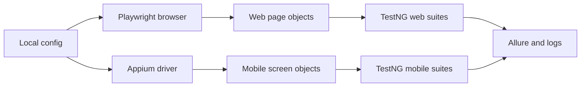

# Playwright and Appium E-commerce Automation Framework

Java automation for a private multi-role commerce application and its customer mobile flow. The repository demonstrates web page objects, API-aware checks, and mobile screen objects; the Android screens are in progress.

Publication approval was obtained for this sanitized portfolio version. Private environments, credentials, app identifiers, screenshots, reports, and company-identifying material are excluded.

## What this demonstrates

- Shared page/screen objects for administration, vendor, storefront, and customer journeys.
- Playwright browser control with TestNG suites and Allure integration.
- Appium-based mobile abstractions with iOS coverage and Android screens in progress.
- API-backed assertions for workflows where a successful UI transition is not sufficient evidence.
- Centralized configuration, retries, logging, and failure artifacts.

## Tech stack

Java 17, Maven, Playwright for Java, Appium Java Client, TestNG, Allure TestNG, Log4j2, Lombok, Jackson, and AspectJ. Exact dependency versions are recorded in `pom.xml`.

## Architecture

```text
src/main/java/com/portfolio/ecommerce/
├── website/   browser manager, config, page objects, web base classes
├── mobile/    Appium drivers, screen objects, mobile flows, listeners
└── data/      shared test data models
src/test/java/com/portfolio/ecommerce/
├── website/   role, API, session, and end-to-end tests
└── mobile/    iOS tests and Android tests in progress
```



## Design decisions

Page objects keep selectors and navigation reusable. Browser and mobile drivers are created centrally so lifecycle, timeouts, and cleanup are consistent. API assertions are used where the UI can close a dialog even though the backend rejects the request. Retries are limited to transient mobile/browser conditions and are reported rather than hidden.

## Coverage and status

A source scan found 65 test files and 257 `@Test` methods. The code covers administration, vendor, storefront, orders, services, payments, sessions, iOS mobile flows, and Android screen/test scaffolding. Android screens are in progress; full execution requires private application environments and devices.

## Setup and run

1. Install Java 17 and Maven. Install Playwright browsers and Appium only for the mobile suites.
2. Copy `config.properties.example` to the local config location expected by the framework and set placeholder-safe environment values for your compatible test environment.
3. Run `mvn -q -DskipTests compile` to verify compilation.
4. Run a selected TestNG suite only when a compatible environment is available.

Generated Allure results, screenshots, videos, and reports are ignored. This repository does not claim test results that were not produced from the sanitized copy.

## Limitations and next steps

The private application and test data are not included. The next improvements are a public demo fixture, a documented Android implementation plan, and CI jobs using disposable test data.

## AI assistance

The framework was developed with AI assistance. The author is responsible for the design, review, sanitization, and execution claims; this is not a claim that every line was typed manually.
